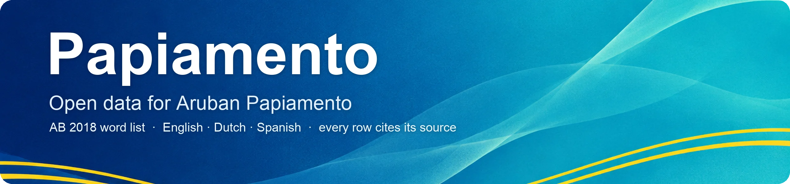
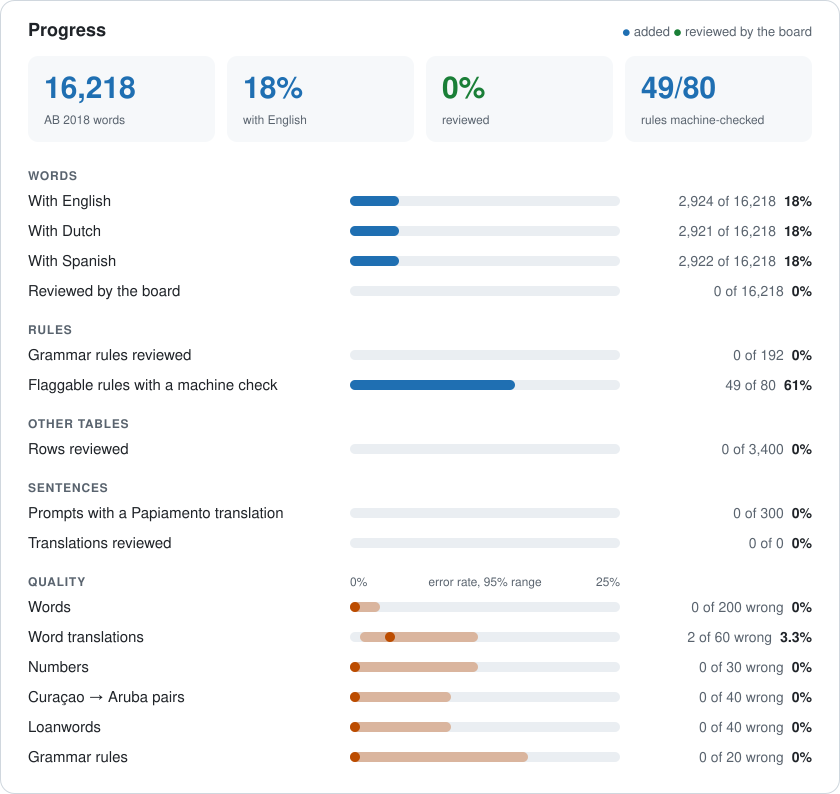

<h1 align="center">
  
</h1>

<p align="center">
  <a href="https://github.com/ARUBAGOV33/papiamento/actions/workflows/gauntlet.yml"></a>
  <a href="https://doi.org/10.5281/zenodo.23427108"></a>
  <a href="https://huggingface.co/datasets/ARUBAGOV33/papiamento"></a>
  <a href="https://github.com/ARUBAGOV33/papiamento/releases"></a>
  <a href="LICENSE-DATA"></a>
  <a href="LICENSE"></a>
  
</p>

<!-- PAP-INTRO: written with AI, every word checked against the AB 2018 list; approved by the maintainer (@victorgomesrt-rgb) on 2026-10-16. -->
> **Papiamento:** Aki bo ta haya un coleccion habri di dato riba Papiamento di Aruba: palabra, regla di ortografia y gramatica, number y mas. Maestro, investigado, gobierno, compania y sistema di inteligencia artificial por uza e dato aki pa skirbi Papiamento corecto. Tur dato ta bini di e fuentenan oficial: e Afkondigingsblad 2018 no. 68 y e bukinan di Departamento di Enseñansa. Bo por yuda: corigi un traduccion, propone un palabra of reporta un eror.

## What this is

This repository is an open, citable reference dataset for **Aruban Papiamento**: the language as it is written in Aruba, in the etymological spelling set out in the AB 2018 no. 68 law and its official word list.

It holds:

- every headword of the AB 2018 word list, with English, Dutch and Spanish translations;
- numbers, days and months, loanwords, names and other closed word lists;
- barbarismos (borrowed forms to avoid) with the Aruban form to use instead;
- a map from Curaçao spellings to Aruban spellings;
- spelling and grammar rules, in plain words and in a machine-readable form;
- test sets for checking tools and models.

Every row says which source it comes from and on which printed page. Everything is plain text (tab-separated files) that opens in a spreadsheet, a text editor or any programming language.

It is written for:

- **teachers and linguists** who want a single, checkable reference;
- **government bodies** that publish in Papiamento;
- **companies** building spell checkers, keyboards, translation or speech tools;
- **people training AI models** who need clean, labelled Aruban data.

## Why an Aruban dataset

Papiamento is written in two standards:

| | Aruba | Curaçao and Bonaire |
|---|---|---|
| Name | Papiamento | Papiamentu |
| Spelling | Etymological (follows the origin of the word) | Phonological (follows the sound) |
| Example | cas, educacion | kas, edukashon |
| Language tag | `pap-AW` | `pap-CW` |

Both are correct in their own place. But most Papiamento text online uses the Curaçao standard, and both standards share one language code, `pap`. Models and spell checkers trained on that text learn Curaçao spelling and then use it for Aruba.

This dataset keeps the two apart. Canonical columns hold Aruban Papiamento only. Curaçao forms appear in one place, `lexicon/variants/curacao-aruba.tsv`, mapped to the Aruban form.

## What's inside

```
_meta/            Conventions, schemas, invariants, known facts, allowlists, audits, milestones
_templates/       Starter files: word row, grammar rule, source card, errata row,
                  audit row, contributor row, parallel prompt row
lexicon/
  words/A-Z/      words.tsv per letter: every AB 2018 headword with EN, NL, ES
  numbers/        Cardinals, ordinals, fractions and clock times
  calendar/       Days, months and public holidays
  barbarismos/    Forms to avoid, with the Aruban form to use instead
  variants/       Curaçao spelling mapped to Aruban spelling
  loanwords/      Loanwords, their origin and the accepted Aruban form
  names/          Proper names: places, demonyms, peoples, languages, titles
  closed-classes/ Pronouns, articles, prepositions, conjunctions, tense markers, modals
  verb-forms/     Gerunds and participles, linked to their base verb
grammar/          Rules in plain language, one file per rule: orthography,
                  morphology, syntax, prepositions, style
rules/            Machine-readable checker rules, each with its own tests
corpus/           Aruban text we may redistribute, and parallel English/Spanish →
                  Aruban Papiamento sentences (CC0) in corpus/parallel/
eval/             Test sets for the writing auditor and for AI models, including
                  held-out parallel sentences
sources/          Source registry (sources.tsv), source cards, shareable PDFs,
                  errata and permission records
release/          Template of the Hugging Face dataset card
tools/            The validator, build scripts and the contribution tool
tests/            Tests for the validator
CLAUDE.md         Routing notes for AI agents
AGENTS.md         Points other AI agents to CLAUDE.md
```

Every top-level folder has a `README.md` that says what lives there, including its sub-folders, and how to add to it.

Start with [`_meta/conventions.md`](_meta/conventions.md). It explains the file format, ids, status values and source citations that every table follows. [`_meta/invariants.md`](_meta/invariants.md) lists the spelling and grammar rules that are not up for debate.

## Project status

Version 0.2.0 was published on 20 October 2026: [release files](https://github.com/ARUBAGOV33/papiamento/releases/tag/v0.2.0), [Zenodo archive](https://doi.org/10.5281/zenodo.23487394) and [Hugging Face dataset](https://huggingface.co/datasets/ARUBAGOV33/papiamento). It adds the closed word classes, names, verb forms, the sentence prompts (with a held-out test set), the audits, the public holidays and the maintainer's rulings of October 2026. Version 0.1.0, the first release, came out on 16 October 2026 ([Zenodo](https://doi.org/10.5281/zenodo.23427109)). See [CHANGELOG.md](CHANGELOG.md).

<!-- REPO-PROGRESS:START -->
<!-- Generated by tools/build_pages.py from the data. Do not edit by hand. -->
Milestones: **P0 Foundation** ✅ done · **P1 Clean data** 🟡 in progress · **P2 Community** 🟡 in progress · **P3 Products** ⬜ not started · **P4 Speech and AI** ⬜ not started. [What is left](_meta/milestones.tsv)

<picture>
  <source media="(prefers-color-scheme: dark)" srcset=".github/assets/progress-dark.svg">
  
</picture>

| Table | Rows | Reviewed by the board | Measured error rate |
|---|---:|---:|---|
| [Words](lexicon/words/) (AB 2018 word list) | 16,218 | 0 | 0% (0 of 200)<br><sub>95% CI 0–1.9%, checked by machine on 2026-10-17</sub><br>Translations: 3.3% (2 of 60)<br><sub>95% CI 0.9–11.4%, checked by machine on 2026-10-17</sub> |
| Numbers | 159 | 0 | 0% (0 of 30)<br><sub>95% CI 0–11.4%, checked by machine on 2026-10-17</sub> |
| Calendar (days, months, public holidays) | 30 | 0 | not audited yet |
| Barbarismos | 42 | 0 | not audited yet |
| Curaçao → Aruba spelling pairs | 372 | 0 | 0% (0 of 40)<br><sub>95% CI 0–8.8%, checked by machine on 2026-10-17</sub> |
| Loanwords | 315 | 0 | 0% (0 of 40)<br><sub>95% CI 0–8.8%, checked by machine on 2026-10-17</sub> |
| Closed word classes (articles, pronouns, particles, modals, conjunctions, prepositions) | 181 | 0 | not audited yet |
| Names (places, demonyms, peoples, languages, religion, titles) | 380 | 0 | not audited yet |
| Verb forms (gerunds and participles) | 1,921 | 0 | not audited yet |
| [Sentence prompts](corpus/parallel/) (English and Spanish; 45 held out for tests) | 300 | 0 | not audited yet |
| Aruban Papiamento sentence translations | 0 | 0 | not audited yet |
| [Grammar rules](grammar/) | 192 | 0 | 0% (0 of 20)<br><sub>95% CI 0–16.1%, checked by machine on 2026-10-17</sub> |
| [Machine checker rules](rules/) | 49 | | not audited yet |

Measured error rate: the share of wrong rows in the latest random audit of the table against the source PDFs, with its 95% Wilson interval (CI). The audits are logged in [`_meta/audits.tsv`](_meta/audits.tsv). "Checked by machine" means software or an AI model did the checking, not yet a person.
<!-- REPO-PROGRESS:END -->

- Every headword of the AB 2018 word list is in `lexicon/words/A`–`Z`, checked against the printed law and the Papiamento.aw list. The most frequent words have machine-drafted English, Dutch and Spanish translations, marked `translated_by = machine` until a person reviews them. [Progress per letter](lexicon/words/README.md).
- The review board is being recruited. Until it checks a row, that row stays `draft`.
- **Bug hunt (October 2026):** AI checker agents compared samples of each table with the page images of the source PDFs. They found 2 wrong machine translations out of 60 and no errors in the other samples. The rows found wrong were fixed in [#15](https://github.com/ARUBAGOV33/papiamento/pull/15). No person has repeated these audits yet. The results are the error rates in the table above.
- **Rulings audit (October 2026):** every grammar rule now rests on a printed page or a dated maintainer decision. The last open question was settled on 19 October 2026: gusta is used with or without ta, as the books say (err-0023 in [`sources/errata.tsv`](sources/errata.tsv)).
- **Closed word classes (October 2026):** 181 articles, pronouns, tense/aspect particles, modal and other dependent verbs, conjunctions and prepositions, copied from Morfologia with page and section, are in [`lexicon/closed-classes/`](lexicon/closed-classes/). They stay `draft` until the review board checks them against the page.
- **Names (October 2026):** the 380 proper names of the AB 2018 word list are in [`lexicon/names/`](lexicon/names/): countries, places, demonyms such as Arubano, peoples, languages, religious names, holidays, titles, planets, zodiac signs and institutions, sorted by the capitalisation rules of AB 2018 §9.3 and linked to their headword in `lexicon/words/`. Their kind and English gloss are machine-written and stay `draft` until the review board checks them.
- **Verb forms (October 2026):** 1,921 gerunds and participles are in [`lexicon/verb-forms/`](lexicon/verb-forms/): 51 from Morfologia's chapter on the verb, with page and section, and 1,870 that the AB 2018 word list prints as headwords, each linked to its base verb. Only printed forms are listed; none is generated by rule. They stay `draft` until the review board checks them.
- **Loanword origins (October 2026):** AB 2018 §12.2 lists Dutch, English and French loans together without saying which is which. 18 of the 21 loanwords marked `other` now have an origin taken from a dictionary or the brand owner, cited in the row: 13 English (including US brands such as kleenex and kodak), 3 French (caret, comer, comper), 1 Dutch (wak) and 1 Spanish (choller, from Latin-American Spanish *cholo*). rom, piks and coecoei stay `other`; their notes say what was checked. See [#37](https://github.com/ARUBAGOV33/papiamento/pull/37).
- **Watchdog trial (October 2026):** before building the weekly watchdog, an AI decision model (TypeSafe's Jev) was tried on 902 test questions built from the repository's known errors. It was a useful first filter for wrong translations, but it could not tell Aruban from Curaçao spelling or right from wrong spelling. So spelling stays with the rules in [`rules/`](rules/) and the review board. Any model only proposes; people decide.
- **Parallel sentences (set up October 2026):** the tables for everyday English and Spanish sentences and their Aruban Papiamento translations are ready in `corpus/parallel/`, with 15% held out in `eval/parallel/`, under CC0 so they can go to Common Voice. Batch 1 holds 300 everyday prompts (machine-drafted in English and Spanish, `draft` until a maintainer checks them): 255 in `corpus/parallel/`, 45 held out. There are no Papiamento translations yet. Teachers will write them through the contribution tool ([`tools/contribute/`](tools/contribute/)), published at <https://arubagov33.github.io/papiamento/>: sign-in by emailed code, two independent answers per item, the review board's decisions brought in by a weekly pull request. Everyone credited is listed in [`_meta/contributors.tsv`](_meta/contributors.tsv).
- **Contribution tool (live since 19 October 2026):** <https://arubagov33.github.io/papiamento/>. Teachers sign in with an email code, check translations, translate words and write sentences; two people answer each item and the review board confirms. The privacy rules passed their tests in the database and from outside. Next: a pilot with 3–5 teachers. How it works: [`tools/contribute/`](tools/contribute/).
- The milestones line, the chart and the table above are rebuilt from the data after every change. While a table has no rows, a "Still empty" line under the table names it.

## How to use it

### Teachers and linguists

1. Open a letter folder, for example [`lexicon/words/`](lexicon/words/), then a letter, then `words.tsv`. GitHub shows the file as a table you can search.
2. To work with it in Excel or Google Sheets, use the **Download raw file** button above the table, then open the file in your spreadsheet. If Excel asks for the file origin or encoding, choose **UTF-8**, or letters like ñ will show up wrong.
3. Check the `status` column. Only `reviewed` rows have been checked by the review board.

Found a mistake? See [How to contribute](#how-to-contribute). You do not need to know any programming.

### Developers and AI trainers

All tables are UTF-8 TSV files with a header row, one tab between cells, no quoting. An empty cell means "not known yet". Several values in one cell are separated by `; `.

Each row has a `status`:

| Status | Meaning |
|---|---|
| `draft` | Entered by a person or a machine; not yet checked by the review board. |
| `reviewed` | A review-board member checked it against the source page. `reviewed_by` names them. |
| `disputed` | Reviewers disagree or sources conflict. See `notes` and `sources/errata.tsv`. |
| `deprecated` | Kept for history; no longer valid. |

**If you want only verified data, keep the rows where `status == reviewed`.** Machine-made content, including AI translations, is always `draft`. In word files, a `translated_by` that includes `machine` marks translations a machine drafted; filter on it to leave them out entirely.

Reading the files in Python, with no dependencies:

```python
import csv
from pathlib import Path

rows = []
for path in sorted(Path("lexicon/words").glob("*/words.tsv")):
    with path.open(encoding="utf-8", newline="") as f:
        rows += csv.DictReader(f, delimiter="\t", quoting=csv.QUOTE_NONE)

reviewed = [r for r in rows if r["status"] == "reviewed"]
```

If you use pandas, turn off its missing-value guessing. Otherwise it reads real words such as `nan` as "not a number":

```python
pd.read_csv(path, sep="\t", dtype=str, quoting=3, keep_default_na=False, na_filter=False)
```

Please keep Aruban (`pap-AW`) and Curaçao (`pap-CW`) data separate and labelled in anything you build.

**Do not train on `eval/`.** It holds test sets for measuring tools and models. [`eval/README.md`](eval/README.md) gives a canary string you can search for, to check that your training data does not contain them.

Each release also ships the tables as JSON Lines files, with a dataset card and `rule_pack.json` for writing checkers. They are attached to each [GitHub release](https://github.com/ARUBAGOV33/papiamento/releases), and Zenodo archives each version with its own DOI ([all versions](https://doi.org/10.5281/zenodo.23427108)). Each release is also published as a [Hugging Face dataset](https://huggingface.co/datasets/ARUBAGOV33/papiamento), so you can load a table with one line: `load_dataset("ARUBAGOV33/papiamento", "words")`. To build the same files yourself, run `python3 tools/build_dist.py`; they land in `dist/`.

## How to contribute

Teachers, linguists and other speakers are the most valuable contributors. You can:

1. fix or add a translation;
2. report a wrong word or spelling;
3. propose a rule;
4. add a test case for the writing auditor (the auditor is coming soon).

Each can be done through a simple form, with no code. See [CONTRIBUTING.md](CONTRIBUTING.md).

Every pull request runs the validator ("the gauntlet") through GitHub Actions. You can run it yourself with `python3 tools/validate.py` (Python 3.9 or newer, no extra packages). It checks:

| Gate | Checks |
|---|---|
| G0 Source trace | Every source id exists in `sources/sources.tsv`; reviewed rows have a source and a page; PDFs and permissions are recorded |
| G1 Format | UTF-8, tabs, line endings, header, sort order, no stray spaces or curly apostrophes |
| G2 Schema | Required values, allowed values, patterns, uniqueness |
| G3 Orthography | Aruban spelling, such as no accents and the right letter folder; warnings for Curaçao spellings |
| G4 Integrity | Ids unique across all tables; references between tables |
| G5 Known facts | Rulings that must never regress |

Details are in [`tools/README.md`](tools/README.md).

## Sources and source of truth

The source PDFs are the source of truth:

- **AB 2018 no. 68**: the law published in Aruba's official gazette in 2018, with its spelling rules and official word list.
- Books by the **Departamento di Enseñansa**: Ortografia (2009), Vocabulario (2009), Morfologia (2010), Sintaxis (2015), and Preposicion y Interheccion (2016).
- Other sources listed in [`sources/sources.tsv`](sources/sources.tsv).

How this works in practice:

- Every row cites a source id and the page number **as printed** in that source. Each source card in `sources/cards/` records the offset between printed and PDF page numbers, so anyone can open the exact page.
- OCR text, scraped data and older files are working copies. When a working copy disagrees with the PDF, the PDF wins.
- When two PDFs disagree, or a PDF contains a typo, the case goes into [`sources/errata.tsv`](sources/errata.tsv) and the review board decides. Nobody picks a winner silently.
- Nothing is copied from copyrighted dictionaries, websites, Glosbe or newspapers.

## How this dataset was made

People decide; machines help. Parts of this dataset were made with the help of AI models (Claude, by Anthropic):

- rebuilding the AB 2018 word list from the PDF, then checking it against the printed pages and the Papiamento.aw list;
- drafting the English, Dutch and Spanish translations;
- restating the spelling and grammar rules from the source books, and writing the machine-readable rules and the tools.

Every piece was checked by a separate run that compared it with the page images; for translations, a second model checked each cell. The maintainer decided every conflict between sources (see [`sources/errata.tsv`](sources/errata.tsv)).

Anything a machine made stays `draft`, and machine translations are marked `translated_by = machine`. A row becomes `reviewed` only when a person on the review board has checked it against the source page.

AI models are not listed as authors, because they cannot take responsibility for the work. Pull requests made with Claude say so in their description, and many early commits carry a "Co-Authored-By: Claude" line. See also "Machine-made content" in [GOVERNANCE.md](GOVERNANCE.md).

## Licences

| What | Where | Licence | File |
|---|---|---|---|
| Code | `tools/`, `tests/`, `.github/` | Apache-2.0 | [LICENSE](LICENSE) |
| Data and documentation | Everything else we author: `lexicon/`, `grammar/`, `rules/`, `corpus/`, `eval/`, `_meta/`, `_templates/`, and the cards and tables in `sources/` | CC BY 4.0 | [LICENSE-DATA](LICENSE-DATA) |
| Parallel sentences | `corpus/parallel/`, `eval/parallel/`: English and Spanish prompts and their Aruban Papiamento translations | CC0 1.0 | [LICENSE-DATA](LICENSE-DATA) |
| Source PDFs | `sources/pdf/` | Each file keeps its own terms, recorded in `sources/sources.tsv` | |
| Voice recordings (planned) | | CC0 | |

The licences cover what this project's contributors wrote. Text reproduced from a source keeps that source's terms: see `sources/sources.tsv`, and `corpus/manifest.tsv` for corpus files.

The AB 2018 law is public domain. The Departamento di Enseñansa books are republished with permission from the Departamento di Enseñansa, granted through the Minister of Education and Innovation. The permission records are in `sources/permissions/`.

To attribute the data, write: "Papiamento Open Data contributors, https://github.com/ARUBAGOV33/papiamento, CC BY 4.0".

## How to cite

Citation details are in [CITATION.cff](CITATION.cff). On GitHub, use the **Cite this repository** button in the right-hand sidebar to get APA or BibTeX.

Cite the version you used. For version 0.2.0:

> Papiamento Open Data contributors (2026). *Papiamento: open data for Aruban Papiamento* (Version 0.2.0) [Data set]. Zenodo. https://doi.org/10.5281/zenodo.23487394

Version 0.1.0 is https://doi.org/10.5281/zenodo.23427109.

To refer to the dataset in general, use the DOI that always points to the latest version: https://doi.org/10.5281/zenodo.23427108. If you rely on a specific word or rule, also cite the source and page given in that row.

## Governance

The project is run by its maintainers, [@ARUBAGOV33](https://github.com/ARUBAGOV33) and [@victorgomesrt-rgb](https://github.com/victorgomesrt-rgb), and a review board of Aruban teachers and linguists. The board is being recruited. Until it has at least two members, the maintainers do its work.

Changes to language content need an approving review from a code owner. Only review-board members can mark a row `reviewed`. See [GOVERNANCE.md](GOVERNANCE.md) for roles, approvals, disputes and releases.

Everyone taking part follows the [Code of Conduct](CODE_OF_CONDUCT.md).

## Acknowledgements

- The **Departamento di Enseñansa** and the **Ministry of Education and Innovation** of Aruba, for permission to republish the Departamento di Enseñansa books.
- The authors and editors of the source books and of the AB 2018 word list, whose work this dataset is built on.
- **Vadria Innovation Labs**, for supporting the project.
- Everyone who reports a mistake, adds a translation or reviews a row.
